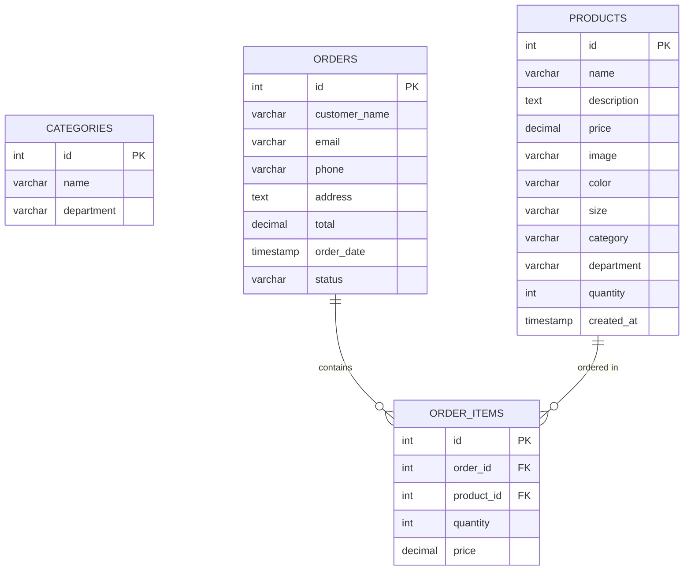

# Fashion Cube - Fashion E-Commerce Website 👗🛍️
### Full-Stack Web Application

**Fashion Cube** is a clean, modern, and responsive fashion e-commerce web application. It provides an intuitive online shopping experience where users can browse fashion items categorized by department, search and filter products, view rich product details, manage their shopping bag, and place orders. It also includes an administrative management dashboard for catalog and order fulfillment.

---

## 🌟 Key Features

### 1. Home Page
- **Hero & Banner Section**: High-fashion banner with headlines and direct department call-to-action buttons.
- **Value Proposition Bar**: Highlighting complimentary shipping, 30-day returns, and authentic fashion.
- **Department Showcase**: Visual curated cards for **Women**, **Men**, and **Kids**.
- **Featured Collection**: Interactive department tab filter (All, Women, Men, Kids).
- **Seasonal Promotion Banner**: Highlighting mid-season promotional collections.
- **New Arrivals**: Quick showcase of the latest additions.
- **Responsive Footer**: Includes department links, project details, and newsletter subscription form.

### 2. Department & Category Navigation
- **Women**: Basics, Blazer
- **Men**: Knitwear, Jeans, Jackets
- **Kids**: Girl, Boy

### 3. Product Catalog, Search & Filters
- **Real-time Search**: Search products by name and keywords.
- **Department & Category Filtering**: Filter products instantly with active filter tags.
- **Price Range Filter**: Interactive max-price slider.
- **Sorting Options**: Sort by Newest, Price: Low to High, and Price: High to Low.

### 4. Product Details
- High-resolution product images.
- Title, category tag, and price display.
- Size selector (`S, M, L, XL`, etc.) and color badge.
- Live inventory stock availability indicator.
- Quantity selector (+ / -).
- Instant "Add to Cart" button with feedback.
- Recommended related products from the same department.

### 5. Shopping Bag (Cart)
- Persistent cart state using React State & `localStorage`.
- Increase / decrease quantity or remove items.
- Real-time calculation of subtotal, complimentary shipping qualification, and total.

### 6. Checkout & Order Placement
- Clean checkout form collecting Customer Name, Email, Phone, and Delivery Address.
- Order review summary with item thumbnails, quantities, and totals.
- **"Place Order"**: Saves the order to the MySQL `orders` table and individual items into `order_items` table, while automatically reducing product stock.
- Order confirmation screen displaying unique **Order Reference Number** (#FC-XXXXX).

### 7. Admin Portal (CRUD Operations)
- **Product Management**:
  - View all products in a structured table.
  - Add new products with image, department, category, price, and sizes.
  - Edit existing product information.
  - Quick inline stock update.
  - Delete products with confirmation.
- **Customer Orders**:
  - View all orders placed in MySQL.
  - Expandable order items showing purchased products, quantities, and price breakdown.
  - Live MySQL connection status badge.

---

## 💻 Tech Stack

- **Frontend**: React.js (Vite), React Router v7, Lucide React (Icons)
- **Styling**: Vanilla CSS (Modern design system with custom variables, smooth transitions, and mobile responsiveness)
- **Backend**: Node.js, Express.js, CORS, Dotenv
- **Database**: MySQL 8.0 (`mysql2` connection driver)

> **Important**: This project intentionally keeps the codebase simple, transparent, and modular using lightweight React Context and direct MySQL drivers.

---

## 🗄️ Database Structure (`fashion_cube`)

The database consists of 4 relational tables defined in [`database.sql`](./database.sql):



---

## 📁 Project Directory Structure

```
E-commerce/
│
├── frontend/
│   ├── src/
│   │   ├── components/
│   │   │   ├── Navbar.jsx & Navbar.css
│   │   │   ├── Footer.jsx & Footer.css
│   │   │   ├── ProductCard.jsx & ProductCard.css
│   │   │   ├── ProductList.jsx & ProductList.css
│   │   │   ├── SearchBar.jsx & SearchBar.css
│   │   │   └── CategorySection.jsx & CategorySection.css
│   │   ├── pages/
│   │   │   ├── Home.jsx & Home.css
│   │   │   ├── ProductsPage.jsx & ProductsPage.css
│   │   │   ├── ProductDetails.jsx & ProductDetails.css
│   │   │   ├── Cart.jsx & Cart.css
│   │   │   ├── Checkout.jsx & Checkout.css
│   │   │   └── Admin.jsx & Admin.css
│   │   ├── context/
│   │   │   └── CartContext.jsx
│   │   ├── App.jsx & App.css
│   │   ├── index.css
│   │   └── main.jsx
│   ├── index.html
│   ├── vite.config.js
│   └── package.json
│
├── backend/
│   ├── server.js          # Express API endpoints
│   ├── db.js              # MySQL connection & auto-table init
│   ├── .env               # Database credentials config
│   ├── .env.example       # Example configuration
│   └── package.json
│
├── database.sql           # Complete MySQL schema & initial seed data
└── README.md              # Project documentation
```

---

## 🚀 Step-by-Step Installation & Running Guide

### 1. Prerequisites
- **Node.js** (v18 or higher)
- **MySQL Server** (v8.0)

---

### 2. MySQL Database Setup

1. Open your MySQL Command Line Client or MySQL Workbench:
   ```bash
   mysql -u root -p
   ```
2. Run the provided SQL script to create the database, tables, and sample data:
   ```sql
   SOURCE c:/Users/Monica/OneDrive/Desktop/E-commerce/database.sql;
   ```
   *(Or copy and paste the contents of [`database.sql`](./database.sql) into MySQL Workbench and execute).*

3. Update your database password in [`backend/.env`](./backend/.env):
   ```env
   DB_HOST=localhost
   DB_USER=root
   DB_PASSWORD=your_mysql_password_here
   DB_NAME=fashion_cube
   DB_PORT=3306
   PORT=5000
   ```

---

### 3. How to Run the Backend

1. Open a terminal and navigate to the `backend` folder:
   ```bash
   cd backend
   ```
2. Install dependencies (if not already installed):
   ```bash
   npm install
   ```
3. Start the backend server:
   ```bash
   npm start
   ```
   *The backend server will run at: `http://localhost:5000`*

---

### 4. How to Run the React Frontend

1. Open a new terminal and navigate to the `frontend` folder:
   ```bash
   cd frontend
   ```
2. Install dependencies (if not already installed):
   ```bash
   npm install
   ```
3. Start the Vite development server:
   ```bash
   npm run dev
   ```
4. Open your browser and navigate to:
   ```
   http://localhost:3000 (or the port shown in terminal, e.g. http://localhost:3001)
   ```

---

## 🧪 Testing the User Flow

1. **Browse**: Visit the Home page, scroll through featured collections and promo banners.
2. **Filter & Search**: Click **Women** -> **Blazer** or search for *"Jeans"* using the search bar.
3. **Product Details**: Click on a product card, choose your size, and click **Add to Cart**.
4. **Cart**: Open the shopping cart in the navbar to verify quantities and subtotal.
5. **Checkout**: Click **Proceed to Checkout**, enter your name, phone, email, and address, then click **Place Order**.
6. **Order Stored**: Notice the order confirmation screen with the reference ID.
7. **Admin Portal**: Click **Admin** in the navigation bar to see your placed order with line items and to manage or add new products.

---

## 💡 Technical & Architectural Highlights

- **Architecture**: 3-Tier Architecture (`React Frontend` ➔ `Express Node.js Backend API` ➔ `MySQL Database`).
- **Data Persistence**: Products and placed customer orders are stored directly in MySQL relational tables with foreign key constraints.
- **Resilience**: The backend features an automatic table creation check on startup to ensure zero-friction setup on examiner machines.
- **Code Clarity**: Written using clean ES6 JavaScript, standard React hooks (`useState`, `useEffect`, `useContext`), and parameterized MySQL SQL queries to prevent SQL injection.
